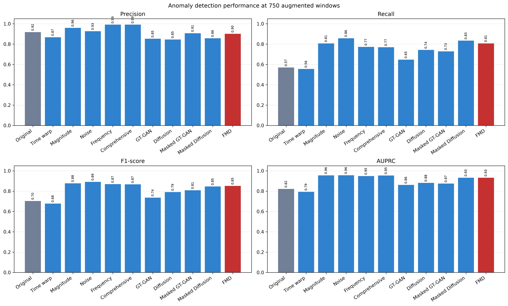

# Manufacturing Time-Series Anomaly Detection

제조 용접 공정에서 불량 학습 표본이 적을 때 데이터 증강이 이상 탐지 성능에 미치는 영향을 비교한 연구 프로젝트입니다. 전통적 시계열 증강과 생성형 증강을 Random Forest 분류기로 평가하고, Filtered Masking Diffusion(FMD)의 품질 필터링과 판정 임계값을 분석합니다.

## 연구 내용

- 정상 학습 윈도우 5,000개와 실제 불량 seed 247개를 기준으로 증강 방법 비교
- GT-GAN, Diffusion, 마스킹 기반 생성과 전통적 변환의 효과 분석
- 생성 후보의 품질 필터링, 클래스 구성, 마스킹 비율, 임계값의 영향 분석
- FastAPI와 브라우저 대시보드를 통한 저장된 이상 탐지 모델의 추론 비교

## 대표 결과

아래 수치는 2026-11-07 공개 정리 시점의 `section_4_3_unified/main_comparison.csv`에서 가져왔습니다. 정상 2,785개와 이상 295개로 구성된 평가 윈도우 3,080개를 사용하며, 각 조건의 임계값은 검증 F1으로 선택했습니다. 증강 조건은 불량 표본 750개를 추가했습니다.

| 방법 | Precision | Recall | F1 | AP |
|---|---:|---:|---:|---:|
| Original only | 0.9180 | 0.5695 | 0.7029 | 0.8221 |
| Magnitude warping | 0.9597 | 0.8068 | 0.8766 | 0.9552 |
| Noise injection | 0.9267 | 0.8576 | 0.8908 | 0.9561 |
| Masking Diffusion | 0.8571 | 0.8339 | 0.8454 | 0.9321 |
| FMD | 0.9015 | 0.8068 | 0.8515 | 0.9318 |



증강은 원본 기준 조건의 재현율과 F1을 개선했습니다. 이 비교에서는 Noise injection이 가장 높은 F1을 보였으며, 생성형 방법이 전통적 증강보다 항상 우수하지는 않았습니다. 결과는 해당 데이터·분할·설정에서 얻은 연구 결과이며 현장 성능을 보장하지 않습니다.

[전체 비교 CSV](docs/results/main_comparison.csv) · [실험 조건과 한계](docs/reproduction.md)

## 코드 구성

```text
Research/tools/             전처리·증강·평가·그림 생성 스크립트
Research/fmd_api/           FastAPI 추론 API와 대시보드
Research/requirements-api.txt   API 및 일부 연구 도구의 실행 의존성
docs/results/              공개용 집계 지표
docs/images/               대표 결과와 대시보드 화면
```

대표 코드는 [통일 조건 비교](Research/tools/research_section43_unified.py), [품질 필터링 분석](Research/tools/research09_filtering_strength.py), [추론 API](Research/fmd_api/app.py)에서 확인할 수 있습니다.


위 화면은 기존 Research11 실험의 대시보드입니다. 상단의 최신 통일 조건 비교와 평가 조건이 다릅니다.

## 실행과 공개 범위

이 저장소는 코드와 결과를 검토할 수 있는 공개 포트폴리오입니다. 원본 데이터, 전처리 배열, 생성 표본, 학습 모델, 노트북 실행 출력, 논문 원고와 참고논문 PDF는 현재 공개 트리에 포함하지 않습니다. 따라서 clone만으로 전체 실험이나 API 추론이 실행되지는 않습니다.

[환경 준비 및 필요한 파일](docs/reproduction.md) · [저장·업데이트 방법](docs/workflow.md)

기존 커밋 기록은 보존했습니다. 현재 트리에서 제외한 파일이 과거 커밋에는 남아 있을 수 있으며, 이 정리는 과거 공개 기록의 삭제를 의미하지 않습니다.
