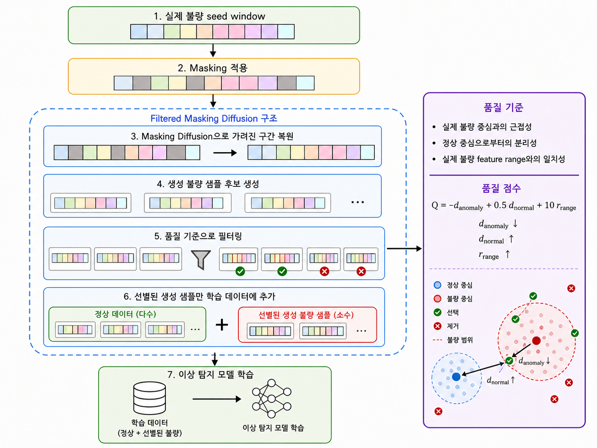

# Manufacturing Time-Series Anomaly Detection Research

제조 용접 공정에서 불량 학습 표본이 적을 때 데이터 증강이 이상 탐지에 미치는 영향을 비교한 연구입니다. 연구 문제 정의부터 기준 모델, 생성형·전통적 증강 비교, 품질 필터링, 임계값과 반복 안정성 분석까지 진행한 과정을 설명합니다.

**이 저장소의 목적은 연구 경험을 설명하고, 독자가 실험을 실행·검토·확장할 수 있도록 코드와 필요한 입력을 함께 제공하는 것입니다.** README는 포트폴리오의 안내 문서이며, 실제 실행은 `Research/run.py`를 기준으로 합니다.

## 연구 질문과 접근

- 실제 불량 seed 247개만 있는 상황에서 증강이 기준 모델의 낮은 재현율을 개선하는가?
- GT-GAN·Diffusion·마스킹 기반 생성은 전통적 시계열 변환과 비교해 어떤 장단점이 있는가?
- 생성 표본의 수량, 품질 필터링, 마스킹 비율과 판정 임계값이 결과를 어떻게 바꾸는가?
- 클래스 구성과 반복 실행을 고려해도 결론이 유지되는가?

실제 불량 seed를 바탕으로 정상–불량 차이가 큰 시간 구간과 변수 그룹을 선택해 마스킹하고, 복원한 생성 후보를 품질 기준으로 선별하는 Filtered Masking Diffusion(FMD)을 분석했습니다. 비교 분류기는 Random Forest입니다.



## 연구 과정과 결과

| 단계 | 수행 내용 | 확인할 자료 |
|---|---|---|
| 입력과 기준 모델 | 라벨 정리, 30시점 윈도우, 정상 학습·불량 seed·검증·평가 분리 | [데이터 구조](Research/data/README.md), [윈도우 재구성](Research/tools/prepare_inputs.py) |
| 생성형 증강 | GT-GAN, Diffusion과 적응형 마스킹의 품질 비교 | [생성 코드](Research/tools/research02_generate_data.py) |
| 증강 후 탐지 | 전통적 변환과 생성형 증강을 같은 조건에서 비교 | [실행 코드](Research/tools/reproduce_comparison.py) |
| 조건 분석 | 클래스 구성, 증강량, 필터링 강도, 마스킹 비율, 반복 안정성 | [연구 과정 상세](docs/research-history.md), [코드 대응표](docs/research-guide.md) |
| 평가 점검 | 기존 분할에서 원시 행 중첩 발견 후 평가 대상 정리 | [분할 처리](Research/tools/research_section441_matched_rf.py), [결과 구분](docs/latest-results.md) |

증강은 원본 기준 조건의 낮은 재현율을 개선했지만, 생성형 방법이 항상 전통적 변환보다 우수하지는 않았습니다. Noise injection과 Magnitude warping도 강한 비교 기준이었으며, FMD는 필터링과 임계값에 따라 정밀도·재현율의 균형이 달라졌습니다. 단일 최고 점수와 반복 안정성, 미검출 비용을 함께 살피는 것이 주요 연구 판단이었습니다.

기존 연구 이력과 이후 수정 평가를 구분했습니다. 기존 분할에는 seed–validation 원시 행 136개, validation–final_test 원시 행 1개의 겹침이 발견되었습니다. 새 실행 경로는 학습·참조 자료와 겹치는 검증 윈도우 39개 및 평가 윈도우 1개를 제외하고, 남은 검증 자료에서만 임계값을 선택합니다. 최종 평가 표본은 정상 2,785개·이상 295개, 총 3,080개입니다.

[기존 연구 설명·결과·그림](docs/research-history.md) · [수정 평가의 기록된 결과](docs/latest-results.md)

## 바로 실행하기

Python 3.13을 기준으로 저장소 루트에서 실행합니다. 기본 비교에는 GPU나 PyTorch가 필요하지 않습니다. 원본 센서 CSV, 분할 자료, 전처리 배열과 저장된 생성 후보를 포함했습니다.

```bash
git clone https://github.com/JHONEY-076/Manufacturing-Time-Series-Anomaly-Detection_Research.git
cd Manufacturing-Time-Series-Anomaly-Detection_Research
python -m venv .venv
```

가상환경 활성화:

```powershell
# Windows PowerShell
.\.venv\Scripts\Activate.ps1
```

```bash
# macOS / Linux
source .venv/bin/activate
```

```bash
python -m pip install -r Research/requirements.txt
python Research/run.py check
python Research/run.py baseline
python Research/run.py compare
```

- `check`: 입력 27개 파일의 해시·형식과 평가 분할 확인
- `baseline`: 원본 학습 자료만으로 RF 학습·검증 임계값 선택·평가
- `compare`: 저장된 생성 후보를 사용해 11개 조건의 RF를 새로 학습·평가

결과는 실행별 `Research/runs/<실행ID>/`에 저장됩니다. `main_comparison.csv`, 개별 예측 `predictions.npz`, 환경·파라미터·입력/코드 해시 `run.json`으로 결과를 검토할 수 있습니다. 기존 결과 파일은 덮어쓰지 않습니다.

## 실험 이어가기

```bash
# 원본 CSV와 기록된 분할에서 전처리 윈도우를 다시 만들고 기존 배열과 대조
python Research/run.py prepare

# RF 설정을 바꿔 별도 실험
python Research/run.py compare --trees 500 --seed 7 --normal-count 5000

# 클래스 구성·필터링·마스킹·30회 반복 안정성까지 실행 (시간이 더 필요)
python Research/run.py full
```

`compare`는 생성 모델을 재학습하지 않습니다. 생성 모델 자체를 바꾸려면 별도 학습 의존성을 설치하고 다음 단계를 사용합니다. 이 두 단계는 기존 `data/researchXX` 후보·결과를 갱신하므로 기존 실험과 구분해 관리하세요.

```bash
python -m pip install -r Research/requirements-training.txt
python Research/run.py generate
python Research/run.py masking
```

[실행 순서·산출물·새 데이터 적용](docs/reproduction.md) · [환경과 검증 기록](docs/validation.md)

## 저장소 구조

```text
README.md                    연구 경험·방법·결과와 실행 시작점
Research/
  run.py                     공통 실행 명령
  requirements*.txt          기본 평가 / 생성 모델 학습 / API 의존성
  data/
    raw_data/                원본 train/test 센서 CSV
    preprocessed/            기존 라벨 자료
    augmentation_split/      분할 배열과 원본 행 메타데이터
    research01~10/           단계별 집계 결과와 저장된 생성 후보
    input_manifest.json      재현 입력의 SHA-256
  notebooks/                 연구 진행 과정의 노트북
  tools/                     전처리·증강·평가·그림 생성 코드
  pictures/                  연구 설명용 그림
  output/                    고정 비교에 필요한 생성 품질 입력
  fmd_api/                   부가 구현: 추론 API와 대시보드
  runs/                      새 실행 결과 (Git 제외)
docs/                        연구 이력·재현 안내·검증 기록
```

## 부가 구현: 대시보드

연구 결과를 응용해 세 모델의 이상 점수·임계값·판정·응답시간을 비교하는 FastAPI와 브라우저 화면을 만들었습니다. 저장된 제조 데이터의 로컬 재생 사례입니다.


[구현 설명](docs/dashboard.md) · [실행 방법](Research/fmd_api/README.md)

## 공개 범위와 해석

PPT·Word·PDF 등 문서 파일, 논문 원고, 참고논문, `codex_tmp` 계열 작업 파일, 가상환경과 실행 로그는 업로드하지 않습니다. 학습된 분류기 파일은 모델 내보내기 코드로 생성합니다.

이 저장소는 기존 연구 입력 스냅샷을 제공합니다. 데이터 외부 출처·재배포 라이선스의 별도 근거는 현재 저장소 자료에 명시되어 있지 않으며, 이 저장소에 포함됐다는 이유로 제3자 자료의 이용 권한까지 부여하는 것은 아닙니다. 재사용 시 원출처의 이용 조건을 확인해야 합니다.

저장된 생성 후보를 이용한 비교는 생성기 재학습의 불확실성까지 검증하지 않습니다. 원시 행 중첩을 제거해도 인접 생산 기록의 독립성이 보장되지는 않습니다. 기존 기록 수치와 현재 환경의 재실행 수치는 구분해 확인하세요. 과거 Git 기록은 보존하므로 현재 제외한 파일이 과거 커밋에 남아 있을 수 있습니다.
