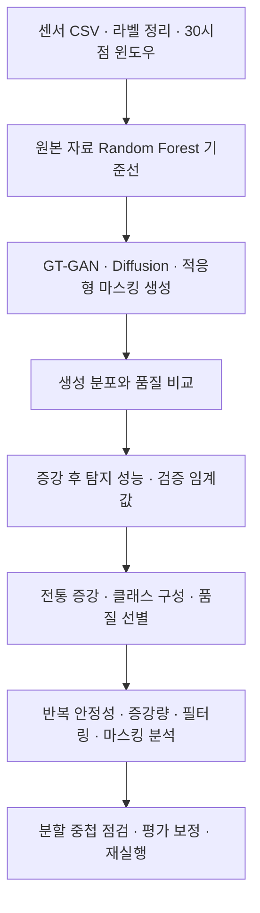
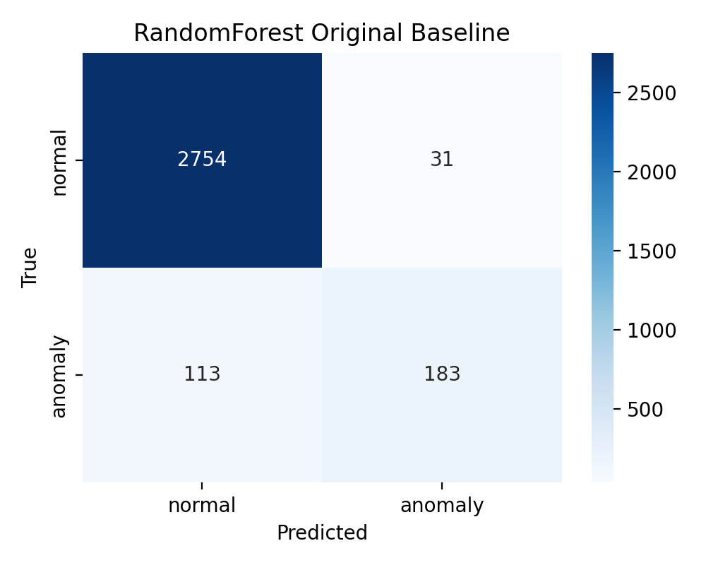
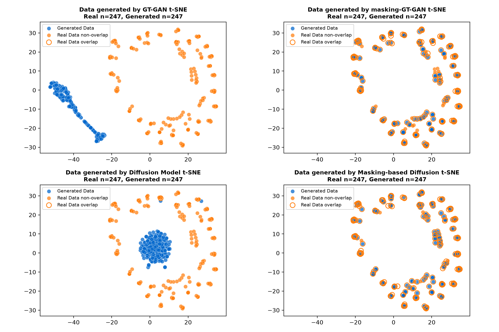
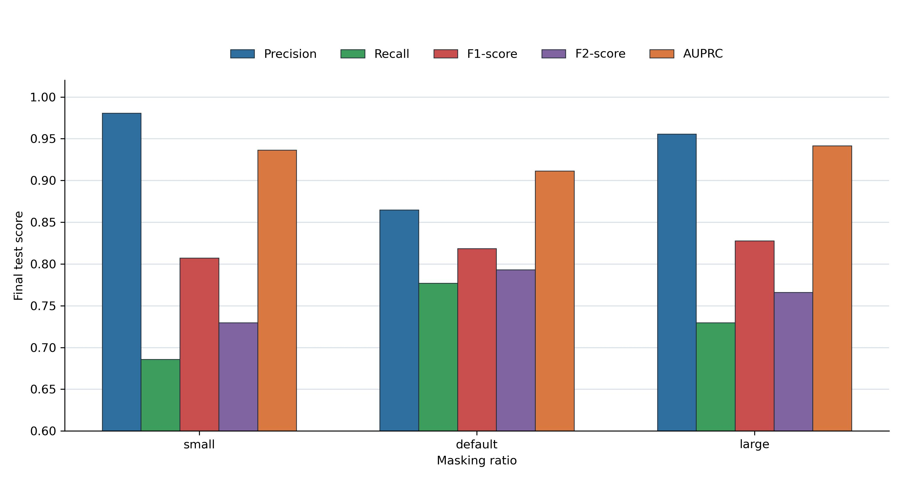

# Manufacturing Time-Series Anomaly Detection Research

제조 용접 공정의 시계열 데이터에서 **실제 불량 seed가 247개뿐인 상황에 데이터 증강을 적용해 이상 탐지 성능을 개선할 수 있는지** 연구했습니다. 정상 데이터가 충분해도 불량 패턴이 적으면 탐지기가 실제 불량을 놓칠 수 있다는 문제에서 출발했습니다.

이 저장소는 문제 정의, 실험 설계, 생성형·전통적 증강 비교, 결과 해석과 평가 방법 점검까지 수행한 연구 경험을 설명하는 포트폴리오입니다. 독자가 분석 과정을 검토하고 실험을 이어갈 수 있도록 코드·노트북·원본 센서 CSV·분할 자료·저장된 생성 후보를 함께 제공합니다.

## 연구 질문

- 불량 seed만 사용한 기준 모델보다 증강 데이터를 추가한 모델의 탐지 성능이 개선되는가?
- GT-GAN·Diffusion·마스킹 기반 생성은 전통적 시계열 증강보다 유리한가?
- 생성 후보를 모두 쓰는 것과 품질 기준으로 선별하는 것의 차이는 무엇인가?
- 임계값, 클래스 구성, 증강량, 필터링 강도와 마스킹 비율은 결과를 어떻게 바꾸는가?
- 단일 최고 점수가 반복 실행과 seed 부족 조건에서도 유지되는가?

## 연구 흐름



아래는 당시 분석 결과를 연구 단계별로 정리한 내용입니다. **기존 Research01–10 결과와 현재 재실행 결과의 조건은 다릅니다.** 기존 분할에서 원시 행 중첩이 발견되어 후속 평가에서 보정했습니다. 당시 결과는 연구 과정의 기록으로 제시하고, 보정 방식과 현재 실행 결과는 뒤의 별도 절에 구분했습니다.

## 데이터와 실험 구성

모델 입력은 `RealPower`, `GateOnTime`, `SetPower`, `Speed`, `Length`의 5개 변수로 구성한 길이 30의 윈도우입니다. 정상 train 자료로 정규화하고, 대부분의 비교에서 정상 윈도우 5,000개와 실제 불량 seed 247개를 사용했습니다. 분류기는 Random Forest이며 판정 임계값은 검증 자료에서 선택했습니다.

| 구분 | 기존 분할 | 현재 평가에 사용하는 수 | 역할 |
|---|---:|---:|---|
| 정상 학습 후보 | 135,730 | 135,730 | 학습·필터 참조용 후보 |
| 실제 불량 seed | 247 | 247 | 실제 불량 학습 표본 |
| 검증 | 1,447 | 1,408 | 판정 임계값 선택 |
| 최종 평가 | 3,081 | 3,080 | 별도 성능 평가 |

[입력 데이터](Research/data/README.md) · [원본 CSV에서 윈도우 재구성](Research/tools/prepare_inputs.py) · [입력 해시](Research/data/input_manifest.json)

## 핵심 방법: Filtered Masking Diffusion

전체 윈도우를 잡음에서 생성하는 방법과 달리, 실제 불량 seed의 관측값을 보존하면서 정상–불량 차이가 큰 시간 구간과 변수 그룹을 선택해 복원하는 마스킹 기반 생성을 분석했습니다. 생성된 후보는 실제 불량 분포와의 근접성, 정상 분포와의 분리, 변수 범위의 일관성을 기준으로 선별합니다.


연구의 초점은 생성 표본을 많이 만드는 데서 그치지 않고, **어떤 후보를 선택하고 어떤 임계값으로 탐지할 때 미검출과 오탐이 어떻게 달라지는지** 확인하는 데 있습니다.

## 단계별 분석 과정과 당시 결과

아래 표·그림은 기존 연구에서 얻은 결과입니다. 서로 다른 증강량·임계값·분석 목적의 실험이 포함되어 있으므로 표 사이 수치를 하나의 동일 조건 순위로 합쳐 해석하지 않습니다. 기존 분할의 중첩 한계도 함께 고려해야 합니다.

### Research01: 원본 데이터 baseline

원본 자료만으로 탐지할 때 어떤 오류가 생기는지 기준선을 먼저 확인했습니다.

실제 불량 seed 247개와 정상 window 5,000개만 사용해 RandomForest baseline을 구성했습니다.

| Method | Precision | Recall | F1 | AUROC | AUPRC |
| --- | ---: | ---: | ---: | ---: | ---: |
| Real anomaly only | 0.855 | 0.618 | 0.718 | 0.959 | 0.800 |

원본 데이터만으로도 precision은 높지만 recall이 낮아, 실제 불량을 놓치는 문제가 확인되었습니다.



[기준 모델 코드](Research/tools/research01_randomforest_baseline.py) · [당시 결과 CSV](Research/data/research01/results/randomforest_original_baseline.csv)

### Research02: 생성 데이터 품질 비교

불량 seed의 수를 늘리는 방법을 비교하고, 생성된 표본이 실제 불량 특성을 반영하는지 분석했습니다.

GT-GAN, Diffusion, Masking GT-GAN, Masking Diffusion을 비교했습니다. 일반 GT-GAN/Diffusion은 noise에서 전체 window를 생성하고, masking 계열은 실제 불량 seed의 관측값을 보존하면서 선택된 시간 구간과 feature group만 복원하도록 구성했습니다.

Masking 전략은 element-wise random masking이 아니라 정상-불량 분포 차이가 큰 시간 영역과 feature group을 우선하는 data-driven adaptive masking입니다. 이 과정에서 RealPower가 가장 큰 feature 차이를 보였고, Masking Diffusion은 GRU 기반 temporal denoiser를 사용했습니다.

품질 평가는 t-SNE, 실제 불량 centroid와의 거리, 정상 centroid와의 분리, IsolationForest downstream 성능으로 확인했습니다. 생성 품질 순위는 대체로 Masking GT-GAN, Masking Diffusion, Diffusion, GT-GAN 순이었습니다.



[생성 코드](Research/tools/research02_generate_data.py) · [생성 품질 지표](Research/data/research02/results/generated_quality_metrics.csv)

### Research03-04: 지도학습 증강과 threshold 최적화

생성 분포가 비슷해 보이는 것과 실제 탐지 성능 개선을 구분하고, 임계값 선택의 영향을 확인했습니다.

생성된 불량 window를 RandomForest 학습 데이터에 추가하고 validation split에서 threshold를 선택한 뒤 final test에서 평가했습니다. Masking Diffusion 1,000개 조건은 baseline보다 F1, recall, AUPRC를 모두 개선했습니다.

| Method | Generated anomalies | Precision | Recall | F1 | AUROC | AUPRC |
| --- | ---: | ---: | ---: | ---: | ---: | ---: |
| Real anomaly only | 0 | 0.855 | 0.618 | 0.718 | 0.959 | 0.800 |
| Masking Diffusion | 1,000 | 0.962 | 0.764 | 0.851 | 0.990 | 0.938 |

Threshold 최적화에서는 precision-recall trade-off가 크게 달라졌습니다. 예를 들어 Masking Diffusion 1,000개에서 best validation F1 threshold는 F1 0.915를 보였고, recall 중심 전략에서는 final recall 0.956까지 올랐습니다.

Filtered Masking Diffusion에서도 threshold 선택은 핵심입니다. Best F1 threshold는 false positive를 낮게 유지하면서 균형 성능을 만들고, Best F2 threshold는 recall을 더 높이는 대신 false positive가 증가하는 방향으로 움직입니다.


추가 threshold 분석 그림:

- [Filtering criteria diagram](Research/pictures/filtered_masking_diffusion_quality_criteria_v2.png)
- [Metric curves](Research/pictures/threshold_metric_curves_filtered_masking_diffusion.png)
- [False positive / false negative curves](Research/pictures/threshold_fp_fn_curves_filtered_masking_diffusion.png)
- [Selected threshold error count bars](Research/pictures/threshold_fp_fn_bar_filtered_masking_diffusion.png)

[증강 평가 코드](Research/tools/research03_model_augmented_validation.py) · [임계값 전략 결과](Research/data/research03/results/masking_diffusion1000_tuned_threshold_strategy_comparison.csv)

### Research05-06: 전통 증강, class balance, 생성 샘플 필터링

생성형 방법의 효과를 판단하기 위해 전통적 증강과 클래스 구성을 비교하고, 생성 후보 선별을 분석했습니다.

Balanced 조건과 imbalanced 조건을 나누어 비교했습니다. 단순히 정상 데이터를 불량 수에 맞춰 줄이는 1:1 class balance는 유리하지 않았습니다. 정상 데이터 정보를 과하게 버리면 final test 성능이 낮아졌습니다.

| Condition | Best method | Precision | Recall | F1 | AUROC | AUPRC |
| --- | --- | ---: | ---: | ---: | ---: | ---: |
| Balanced | Frequency domain | 0.698 | 0.686 | 0.692 | 0.954 | 0.729 |
| Imbalanced | Magnitude warping | 0.964 | 0.814 | 0.883 | 0.994 | 0.959 |

생성형 증강은 생성 샘플을 전부 쓰기보다 품질 기준으로 선별했을 때 실용성이 좋아졌습니다. `Filtered@750 Masking Diffusion`은 생성형 후보 중 가장 중요한 실험 방향이며, baseline 대비 recall을 높이면서도 precision을 높은 수준으로 유지했습니다.

| Method | Generated anomalies | Precision | Recall | F1 | AUROC | AUPRC |
| --- | ---: | ---: | ---: | ---: | ---: | ---: |
| Masking Diffusion | 1,000 | 1.000 | 0.716 | 0.835 | 0.993 | 0.956 |
| Filtered@750 Masking Diffusion | 750 | 0.953 | 0.818 | 0.880 | 0.991 | 0.944 |
| Magnitude warping | 1,000 | 0.964 | 0.814 | 0.883 | 0.994 | 0.959 |

[전통 증강·선별 코드](Research/tools/research05_balanced_aug_experiment.py) · [클래스 구성별 결과](Research/data/research05/results/research05_balanced_augmentation_comparison.csv)

### Research07: threshold 강건성, 반복 안정성, scarce seed

단일 실행의 높은 점수에 의존하지 않도록 반복 실행과 불량 seed 부족 조건을 점검했습니다.

Precision floor 0.90 조건에서 threshold sweep을 수행하고, 주요 후보를 30회 반복 실행해 평균과 분산을 확인했습니다.

| Method | Precision mean | Recall mean | F1 mean | AUPRC mean |
| --- | ---: | ---: | ---: | ---: |
| Original only | 0.838 | 0.564 | 0.668 | 0.784 |
| Masking Diffusion | 0.929 | 0.740 | 0.821 | 0.924 |
| Filtered@750 Masking Diffusion | 0.899 | 0.716 | 0.792 | 0.911 |
| Magnitude warping | 0.931 | 0.802 | 0.860 | 0.950 |

반복 안정성까지 고려하면 Magnitude warping이 가장 안정적인 후보였고, 생성형 후보는 baseline보다 뚜렷하게 좋아졌지만 seed가 극단적으로 적은 조건에서는 한계가 있었습니다.

[반복 안정성 집계](Research/data/research07/results/research07_stability_summary.csv) · [seed 부족 조건 결과](Research/data/research07/results/research07_scarce_seed_summary.csv)

### Research08: 증강량 포화 분석

증강량을 늘릴수록 성능이 계속 개선되는지, 필요한 생성량과 포화 지점이 어디인지 비교했습니다.

50, 100, 200, 500, 750, 1,000개 증강량을 비교해 각 방법이 어느 지점에서 성능이 포화되는지 분석했습니다. 95% plateau 기준으로 Masking Diffusion은 대체로 500개, Filtered Masking Diffusion은 750개 부근에서 주요 지표가 포화되었습니다.

| Augmentation count | Best method by F2 | Precision | Recall | F1 | F2 | AUPRC |
| ---: | --- | ---: | ---: | ---: | ---: | ---: |
| 50 | Frequency domain | 0.734 | 0.716 | 0.725 | 0.720 | 0.799 |
| 100 | Masking Diffusion | 0.885 | 0.676 | 0.766 | 0.709 | 0.850 |
| 200 | Noise injection | 0.833 | 0.743 | 0.786 | 0.760 | 0.871 |
| 500 | Magnitude warping | 0.927 | 0.811 | 0.865 | 0.832 | 0.940 |
| 750 | Filtered Masking Diffusion | 0.952 | 0.807 | 0.874 | 0.833 | 0.943 |
| 1,000 | Filtered Masking Diffusion | 0.833 | 0.845 | 0.839 | 0.842 | 0.922 |


[증강량 분석 코드](Research/tools/research08_augmentation_saturation.py) · [증강량별 결과](Research/data/research08/results/research08_best_f2_by_count.csv)

### Research09: 필터링 강도 분석

후보를 엄격하게 선별하는 것이 항상 좋은지, 미검출과 오탐 사이의 균형이 어떻게 달라지는지 확인했습니다.

Filtered Masking Diffusion의 필터링 강도를 `loose`, `default`, `strict`로 나누어 비교했습니다. 750개 증강 조건에서는 loose filter가 F1, F2, recall 기준으로 가장 좋았습니다.

| Filtering strength | Count | Precision | Recall | F1 | F2 | AUPRC | FN | FP |
| --- | ---: | ---: | ---: | ---: | ---: | ---: | ---: | ---: |
| default | 750 | 0.891 | 0.774 | 0.828 | 0.795 | 0.928 | 67 | 28 |
| loose | 750 | 0.849 | 0.855 | 0.852 | 0.854 | 0.939 | 43 | 45 |
| strict | 750 | 0.882 | 0.780 | 0.828 | 0.799 | 0.907 | 65 | 31 |
| strict | 1,000 | 0.904 | 0.794 | 0.845 | 0.814 | 0.933 | 61 | 25 |

Loose 조건은 anomaly radius를 넓히고 normal radius 기준을 완화해 더 다양한 후보를 남겼습니다. 그 결과 false positive는 늘었지만 false negative가 크게 줄어 recall 중심 목적에 유리했습니다. 제조 불량 탐지처럼 놓친 불량의 비용이 큰 경우에는 이 설정이 Filtered Masking Diffusion의 실무적 장점을 가장 잘 보여줍니다.


[필터링 코드](Research/tools/research09_filtering_strength.py) · [강도별 결과](Research/data/research09/results/research09_filtering_strength.csv)

### Research10: 마스킹 비율 분석

관측값을 얼마나 보존하고 복원하는지가 결과에 미치는 영향을 분리해 살펴봤습니다.

Loose filtering과 750개 target count를 고정하고, Masking Diffusion의 temporal block ratio와 feature group ratio를 비교했습니다.

| Masking ratio | Temporal block | Feature group | Precision | Recall | F1 | F2 | AUPRC | FN | FP |
| --- | ---: | ---: | ---: | ---: | ---: | ---: | ---: | ---: | ---: |
| small | 0.15 | 0.20 | 0.981 | 0.686 | 0.807 | 0.730 | 0.937 | 93 | 4 |
| default | 0.25 | 0.40 | 0.865 | 0.777 | 0.819 | 0.793 | 0.911 | 66 | 36 |
| large | 0.35 | 0.60 | 0.956 | 0.730 | 0.828 | 0.766 | 0.941 | 80 | 10 |

마스킹 비율은 precision과 recall의 균형을 바꿨습니다. Small mask는 매우 높은 precision과 낮은 FP를 보였고, default mask는 recall/F2가 가장 좋았으며, large mask는 F1과 AUPRC 관점에서 좋은 절충안을 보였습니다. 따라서 Filtered Masking Diffusion은 고정된 하나의 증강기가 아니라, 마스킹 강도와 필터링 강도를 조합해 목적 함수에 맞게 조절하는 생성형 증강 프레임워크로 해석할 수 있습니다.



[마스킹 비율 코드](Research/tools/research10_masking_ratio.py) · [비율별 결과](Research/data/research10/results/research10_masking_ratio.csv)

## 평가 방법 점검과 현재 재실행 결과

후속 점검에서 기존 seed–validation 사이 원시 행 136개, validation–final_test 사이 원시 행 1개의 겹침을 발견했습니다. 윈도우 단위 분할만으로 원본 관측 행의 분리가 보장되지 않는다는 점을 확인하고, 학습·참조 자료와 겹치는 검증 윈도우 39개, 학습·검증과 겹치는 평가 윈도우 1개를 제외했습니다. 보정 후 검증 자료에서 임계값을 선택하고 평가 자료에서 지표를 계산합니다.

현재 공개 실행 경로를 검증하며 얻은 결과는 다음과 같습니다. 정상 학습 5,000개, 불량 seed 247개, 증강 조건별 750개, RF 300 trees·seed 42를 사용했습니다. 평가 집합은 정상 2,785개·이상 295개입니다. 저장된 생성 후보를 사용했으며 생성기를 다시 학습한 결과는 아닙니다.

| 방법 | 추가 불량 | Precision | Recall | F1 | AP |
|---|---:|---:|---:|---:|---:|
| Original only | 0 | 0.9222 | 0.5627 | 0.6989 | 0.8090 |
| Time warping | 750 | 0.7418 | 0.6136 | 0.6716 | 0.7865 |
| Magnitude warping | 750 | 0.9907 | 0.7254 | 0.8376 | 0.9403 |
| Noise injection | 750 | 0.9492 | 0.8237 | 0.8820 | 0.9536 |
| Frequency domain | 750 | 0.9911 | 0.7525 | 0.8555 | 0.9606 |
| Comprehensive | 750 | 0.9955 | 0.7458 | 0.8527 | 0.9490 |
| GT-GAN | 750 | 0.9745 | 0.5186 | 0.6770 | 0.8677 |
| Diffusion | 750 | 0.8920 | 0.6441 | 0.7480 | 0.8673 |
| Masking GT-GAN | 750 | 0.9390 | 0.6780 | 0.7874 | 0.8848 |
| Masking Diffusion | 750 | 0.9730 | 0.7322 | 0.8356 | 0.9313 |
| FMD | 750 | 0.9498 | 0.7051 | 0.8093 | 0.9264 |

이 재실행에서 Noise injection은 F1 0.8820로 가장 높았습니다. 원본 기준 조건의 재현율 0.5627에 비해 FMD는 0.7051로 높았지만, F1은 0.8093로 전통적 증강의 최고 결과를 넘지 못했습니다. 생성형 방법의 효과는 비교 조건과 품질 선별 전략을 함께 살펴야 한다는 점을 보여줍니다.

위 표는 현재 환경에서 실행해 보존한 결과입니다. [이전에 기록된 보정 평가](docs/latest-results.md)와도 수치가 완전히 같지는 않으므로 각각의 환경·입력·코드 기록을 구분했습니다. 과거의 모든 결과가 현재 코드로 정확히 재현된다고 주장하지 않습니다.

[현재 재실행 CSV](docs/results/reproduction/main_comparison.csv) · [환경·파라미터·입력·코드 해시](docs/results/reproduction/run.json) · [실행 코드](Research/tools/reproduce_comparison.py) · [검증 기록](docs/validation.md)

## 연구를 통해 얻은 판단

- 정상 자료를 불량 수에 맞춰 과하게 줄이면 유용한 정상 패턴을 잃을 수 있습니다.
- 생성 분포의 시각적 유사성과 후속 탐지 성능은 별도로 평가해야 합니다. t-SNE의 근접만으로 원래 공간의 분포 일치나 새로운 패턴 생성을 입증할 수는 없습니다.
- 증강량을 늘리는 것만으로 성능이 계속 좋아지지는 않았습니다. 후보의 품질·다양성과 선별 강도를 함께 조정해야 합니다.
- 필터링과 마스킹은 정밀도·재현율을 바꾸는 설계 요소입니다. 미검출과 오탐 비용에 따라 선택 기준이 달라집니다.
- 전통적 증강은 강한 기준선입니다. 생성형 방법의 장점은 같은 조건의 비교와 반복 안정성까지 확인해야 합니다.
- 시계열에서는 윈도우뿐 아니라 원본 파일·행 구간의 중첩도 확인해야 합니다. 중첩을 제거해도 인접 생산 기록의 독립성이 보장되는 것은 아닙니다.

이번 공개 구성에서는 별도 폴더에서 11개 조건을 다시 실행해 현재 결과의 일치를 확인했고, 저장한 개별 예측으로 Precision·Recall·F1·F2·AP·AUROC를 검산했습니다. 생성기 전체 재학습, 30회 반복 전체 실행과 실제 공장 장기 운영 검증은 이번 구성 점검에서 수행하지 않았습니다.

## 바로 실행하기

Python 3.13을 기준으로 저장소 루트에서 실행합니다. 기본 비교에는 GPU나 PyTorch가 필요하지 않습니다. 원본 센서 CSV, 분할 자료, 전처리 배열과 저장된 생성 후보를 포함했습니다.

```bash
git clone https://github.com/JHONEY-076/Manufacturing-Time-Series-Anomaly-Detection_Research.git
cd Manufacturing-Time-Series-Anomaly-Detection_Research
python -m venv .venv
```

가상환경 활성화:

```powershell
# Windows PowerShell
.\.venv\Scripts\Activate.ps1
```

```bash
# macOS / Linux
source .venv/bin/activate
```

```bash
python -m pip install -r Research/requirements.txt
python Research/run.py check
python Research/run.py baseline
python Research/run.py compare
```

- `check`: 입력 27개 파일의 해시·형식과 평가 분할 확인
- `baseline`: 원본 학습 자료만으로 RF 학습·검증 임계값 선택·평가
- `compare`: 저장된 생성 후보를 사용해 11개 조건의 RF를 새로 학습·평가

결과는 실행별 `Research/runs/<실행ID>/`에 저장됩니다. `main_comparison.csv`, 개별 예측 `predictions.npz`, 환경·파라미터·입력/코드 해시 `run.json`으로 결과를 검토할 수 있습니다. 기존 결과 파일은 덮어쓰지 않습니다.

## 실험 이어가기

```bash
# 원본 CSV와 기록된 분할에서 전처리 윈도우를 다시 만들고 기존 배열과 대조
python Research/run.py prepare

# RF 설정을 바꿔 별도 실험
python Research/run.py compare --trees 500 --seed 7 --normal-count 5000

# 클래스 구성·필터링·마스킹·30회 반복 안정성까지 실행 (시간이 더 필요)
python Research/run.py full
```

`compare`는 생성 모델을 재학습하지 않습니다. 생성 모델 자체를 바꾸려면 별도 학습 의존성을 설치하고 다음 단계를 사용합니다. 이 두 단계는 기존 `data/researchXX` 후보·결과를 갱신하므로 기존 실험과 구분해 관리하세요.

```bash
python -m pip install -r Research/requirements-training.txt
python Research/run.py generate
python Research/run.py masking
```

[실행 순서·산출물·새 데이터 적용](docs/reproduction.md) · [환경과 검증 기록](docs/validation.md)

## 저장소 구조

```text
README.md                    연구 경험·방법·결과와 실행 시작점
Research/
  run.py                     공통 실행 명령
  requirements*.txt          기본 평가 / 생성 모델 학습 / API 의존성
  data/
    raw_data/                원본 train/test 센서 CSV
    preprocessed/            기존 라벨 자료
    augmentation_split/      분할 배열과 원본 행 메타데이터
    research01~10/           단계별 집계 결과와 저장된 생성 후보
    input_manifest.json      재현 입력의 SHA-256
  notebooks/                 연구 진행 과정의 노트북
  tools/                     전처리·증강·평가·그림 생성 코드
  pictures/                  연구 설명용 그림
  output/                    고정 비교에 필요한 생성 품질 입력
  fmd_api/                   부가 구현: 추론 API와 대시보드
  runs/                      새 실행 결과 (Git 제외)
docs/                        연구 이력·재현 안내·검증 기록
```

## 부가 구현: 대시보드

연구 결과를 응용해 세 모델의 이상 점수·임계값·판정·응답시간을 비교하는 FastAPI와 브라우저 화면을 만들었습니다. 저장된 제조 데이터의 로컬 재생 사례입니다.


[구현 설명](docs/dashboard.md) · [실행 방법](Research/fmd_api/README.md)

## 공개 범위와 해석

PPT·Word·PDF 등 문서 파일, 논문 원고, 참고논문, `codex_tmp` 계열 작업 파일, 가상환경과 실행 로그는 업로드하지 않습니다. 학습된 분류기 파일은 모델 내보내기 코드로 생성합니다.

이 저장소는 기존 연구 입력 스냅샷을 제공합니다. 데이터 외부 출처·재배포 라이선스의 별도 근거는 현재 저장소 자료에 명시되어 있지 않으며, 이 저장소에 포함됐다는 이유로 제3자 자료의 이용 권한까지 부여하는 것은 아닙니다. 재사용 시 원출처의 이용 조건을 확인해야 합니다.

저장된 생성 후보를 이용한 비교는 생성기 재학습의 불확실성까지 검증하지 않습니다. 원시 행 중첩을 제거해도 인접 생산 기록의 독립성이 보장되지는 않습니다. 기존 기록 수치와 현재 환경의 재실행 수치는 구분해 확인하세요. 과거 Git 기록은 보존하므로 현재 제외한 파일이 과거 커밋에 남아 있을 수 있습니다.
