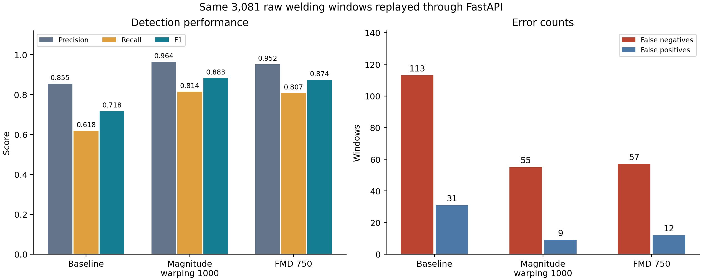

# Research11: Baseline · Magnitude warping · FMD의 FastAPI 비교

실행 시각(UTC): 2026-09-12T06:20:17.561682+00:00

Research01 baseline, Research05 Magnitude warping 1,000개(imbalanced), Research08 Filtered Masking Diffusion 750개 증강 RandomForest를 재학습해 저장하고, Uvicorn/FastAPI를 별도 프로세스로 실행해 실제 localhost HTTP 요청으로 검증했다. 이 실험의 범위는 저장된 원본 제조 데이터의 윈도 단위 재생이다.

## 데이터와 재현성

- 원본: `data/raw_data/train/Training_Data.csv`와 `data/raw_data/test/`의 용접 센서 CSV.
- 입력 순서: RealPower, GateOnTime, SetPower, Speed, Length. 요청당 원시 센서값 30 × 5개.
- train CSV만으로 StandardScaler를 복원했으며, 기존 모든 split의 정규화 윈도와 최대 오차 0을 확인했다.
- raw train CSV의 행 순서가 기존 윈도 생성 당시와 달라, 학습 데이터 검증에는 고유 타임스탬프를 사용했다.
- 세 모델의 기존 결과 재현, 저장 후 재로딩, 원시 입력 API와 기존 정규화 입력의 예측 일치를 확인했다.
- 정상 학습 5,000개·실제 이상 seed 247개·RF 300 trees는 공통이다. 증강 수는 baseline 0개, Magnitude warping 1,000개, FMD 750개다. 각 기존 실험의 seed를 유지했다.
- 최종평가 3081개 윈도(정상 2,785 / 이상 296). Threshold는 validation에서만 선택했다.
- seed/validation/final_test 간 같은 파일의 원시 행 겹침: `{'anomaly_train_seed_vs_validation': 136, 'anomaly_train_seed_vs_final_test': 0, 'validation_vs_final_test': 1}`.
- 기존 split에서 seed–validation 136개 행, validation–final_test 1개 행의 겹침이 발견되었다. 따라서 split의 완전한 독립성은 확보되지 않았으며, 이 결과를 누수 없는 새로운 일반화 평가로 표현하면 안 된다.
- 데이터·코드·모델 SHA-256 및 학습 설정은 `artifacts/research11/manifest.json`에 기록했다.

## 실제 HTTP 추론 결과

| 모델 | Precision | Recall | F1 | AUPRC | FN | FP | API·오프라인 판정 일치 |
| --- | ---: | ---: | ---: | ---: | ---: | ---: | ---: |
| Baseline RF | 0.8551 | 0.6182 | 0.7176 | 0.7999 | 113 | 31 | 100% |
| Magnitude warping 1000 RF | 0.9640 | 0.8142 | 0.8828 | 0.9590 | 55 | 9 | 100% |
| FMD 750 RF | 0.9522 | 0.8074 | 0.8739 | 0.9432 | 57 | 12 | 100% |



`/compare`는 한 요청에서 세 모델을 순차 실행한다. 총 3081개 요청을 원본 윈도의 종료 시각 순으로 가속 재생했으며 오류는 0건이었다. 원래의 수초~수시간 간격으로 대기한 실험은 아니다.

| 측정 항목 | 평균(ms) | p95(ms) | p99(ms) | 최대(ms) |
| --- | ---: | ---: | ---: | ---: |
| HTTP 왕복(세 모델 포함) | 72.851 | 114.864 | 155.299 | 308.110 |
| Baseline RF 정규화+추론 | 23.430 | 39.068 | 51.671 | 84.785 |
| Magnitude warping 1000 RF 정규화+추론 | 23.344 | 38.170 | 52.304 | 110.854 |
| FMD 750 RF 정규화+추론 | 23.389 | 38.113 | 51.103 | 141.603 |

각 모델의 `/predict/{model_name}` endpoint도 별도로 측정했다. 동일한 대표 윈도를 사용하고 모델 호출 순서를 교대했다. 아래는 해당 모델만 실행한 HTTP 왕복시간이다.

| 모델 | 요청 수 | 평균(ms) | p95(ms) | p99(ms) |
| --- | ---: | ---: | ---: | ---: |
| Baseline RF | 100 | 19.433 | 21.316 | 24.076 |
| Magnitude warping 1000 RF | 100 | 19.572 | 21.881 | 24.447 |
| FMD 750 RF | 100 | 19.420 | 21.861 | 23.361 |

별도 부하 검증: 초당 10개 요청을 200회 예약해 전송했다. 예약시점부터 응답까지 p95는 68.900 ms, 100.0 ms 주기 초과는 0건, 요청 오류는 0건이었다. 이 주기는 검증용으로 지정했으며 설비의 확정된 SLA가 아니다.

동시 요청 검증: 클라이언트 4개로 40회 요청했고 오류 0건, 예측 불일치 0건이었다.

입력 계약 검증: 13개 확인 통과 (개별 모델 endpoint, 잘못된 행·열 개수, feature 순서, 비유한 값, 알 수 없는 모델, 추가 필드 등).

## 해석 범위

1. 실제 HTTP API 적용과 이 PC의 시험 부하에서의 응답 지연을 입증한다. 실제 공장 설비 연결, 외부 네트워크 지연, 장기 연속 운전, 미지 분포·다른 설비에 대한 성능은 검증하지 않았다.
2. 윈도 30개를 모으는 시간은 별도다. 최종평가 윈도의 시간 길이는 중앙값 149.454초, 최소 100.426초, 최대 11253.099초다. API 왕복시간은 이미 모인 윈도에 대한 응답시간이며, 이상 발생부터 경보까지의 지연이 아니다. 원본 데이터의 긴 시간 공백을 기존 연구와 동일하게 유지했다.
3. 기존 세 실험을 재현했으므로 증강 수, normal sample seed와 RF seed가 다르다. 이 API 실험만으로 성능 차이를 오직 증강 효과에 귀속하지 않는다. 최종평가 결과는 새 독립 시험이 아니라 기존 split의 재현이다.
4. 기존 FMD 필터를 그대로 사용했다. gate 통과 후보 1000개, fallback_used=False. 이번 실행에서는 1,000개 후보가 모두 gate를 통과했고, quality score 순위로 750개를 선택했다.
5. 저장한 세 joblib은 이상탐지 RandomForest다. Diffusion 생성기 checkpoint는 원래 환경에 없었으며 이번에도 생성기를 재학습하지 않았다. 기존 생성 데이터와 필터로 선택한 750개 샘플을 보존했다.
6. 지표는 서로 겹치는 윈도 단위다. 독립 제품·불량 사건별 탐지율이나 통계적 유의성을 의미하지 않는다.

## 논문에 사용할 수 있는 문장

> 원본 데이터 기반 baseline, Magnitude warping 및 FMD 증강 데이터를 활용해 학습한 세 이상탐지 모델을 저장하고, FastAPI 기반 추론 시스템에 통합하였다. 저장된 실제 용접 공정 데이터를 시간 순서에 따라 윈도 단위로 재생하여 HTTP 요청을 통한 추론을 수행하였으며, 오프라인 결과와의 일치성과 응답 지연을 측정함으로써 실시간 추론을 위한 API 적용 가능성을 검증하였다.

## 실행 및 증빙

```powershell
.\.venv-api\Scripts\python.exe tools/research11_export_api_models.py
.\.venv-api\Scripts\python.exe tools/research11_verify_api.py
.\.venv-api\Scripts\python.exe -m uvicorn fmd_api.app:app --host 127.0.0.1 --port 8000
```

- API 문서: 서버 실행 중 http://127.0.0.1:8000/docs
- `api_verification_summary.json`: 머신 판독 가능한 종합 결과와 실행 환경.
- `api_predictions.csv`: 원본 파일·시각·정답·세 모델 예측·HTTP 지연 기록.
- `three_model_comparison.csv`, `.png`, `.svg`: 모델별 성능·응답시간 비교표와 그림.
- `single_model_requests.csv`: 각 모델 endpoint의 개별 HTTP 측정·예측 검증 기록.
- `paced_requests.csv`, `concurrent_requests.csv`: 부하 검증 요청별 기록.
- `example_request.json`, `example_response.json`: 실제 입력과 응답 예시.
- `server.log`: Uvicorn 실행·요청 로그. `evidence_sha256.json`: 결과 파일 해시.

서버 시작 시 모델을 한 번 로드하는 구조는 [FastAPI 공식 Lifespan 문서](https://fastapi.tiangolo.com/advanced/events/)를 따른다.
측정값은 위 로컬 실험의 결과이며, 공식 문서는 성능 수치의 근거가 아니다.

실행 환경: {'platform': 'Windows-11-10.0.26200-SP0', 'processor': 'Intel64 Family 6 Model 126 Stepping 5, GenuineIntel', 'logical_cpu_count': 8, 'python': '3.13.7', 'versions': {'fastapi': '0.141.1', 'pydantic': '2.13.5', 'uvicorn': '0.38.0', 'httpx': '0.28.1', 'numpy': '2.3.5', 'pandas': '3.0.3', 'scikit-learn': '1.8.0', 'joblib': '1.5.3'}, 'server_workers': 1, 'model_n_jobs': 1, 'url': 'http://127.0.0.1:53020'}
