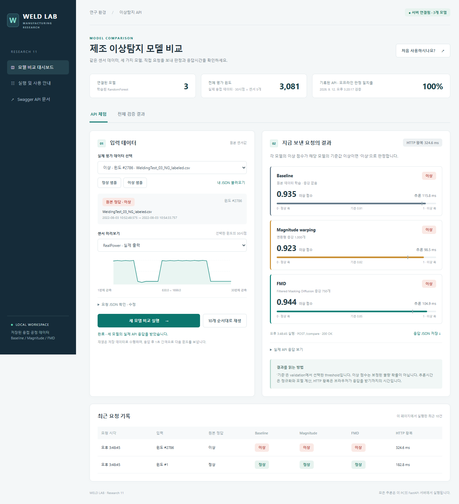

# 추가 구현: 연구 결과를 추론 화면으로 연결

연구에서 비교한 모델을 실제 요청·응답 흐름으로 확인하기 위해 FastAPI와 브라우저 대시보드를 구현했습니다. 연구 과정과 실험 결과를 설명하는 포트폴리오의 부가 사례입니다.

## 구현한 내용

- 저장된 Baseline, Magnitude warping 증강, FMD 증강 Random Forest 모델 비교
- 5개 센서 × 30시점의 원시 입력을 학습 시 정규화 방식으로 변환
- 모델별 이상 점수, 임계값, 판정과 추론 시간 반환
- 정상·이상 예시 선택, 저장 데이터의 순차 재생, 검증 결과 확인

[API 코드](../Research/fmd_api/app.py) · [화면 연결 코드](../Research/fmd_api/dashboard.py) · [프런트엔드](../Research/fmd_api/static/app.js) · [검증 스크립트](../Research/tools/research11_verify_api.py)

## 실행과 해석

[실행 안내](../Research/fmd_api/README.md)에 환경과 모델 내보내기 절차를 정리했습니다. 필요한 연구 데이터는 포함하며 학습된 분류기는 내보내기 코드로 생성합니다. 화면은 기존 로컬 연구 환경에서 실행한 사례이며 외부 공개 서비스 주소는 제공하지 않습니다.

API는 오프라인 증강으로 학습한 분류기를 실행합니다. 요청마다 Diffusion으로 데이터를 생성하지 않습니다. 기존 Research11 모델·평가는 3,081개 평가 실험에 기반하며, README에 구분한 분할 수정 후 3,080개 실험과 같은 결과가 아닙니다. 실제 공장 설비 연동이나 장기 운영 검증도 수행한 것으로 해석하면 안 됩니다.
