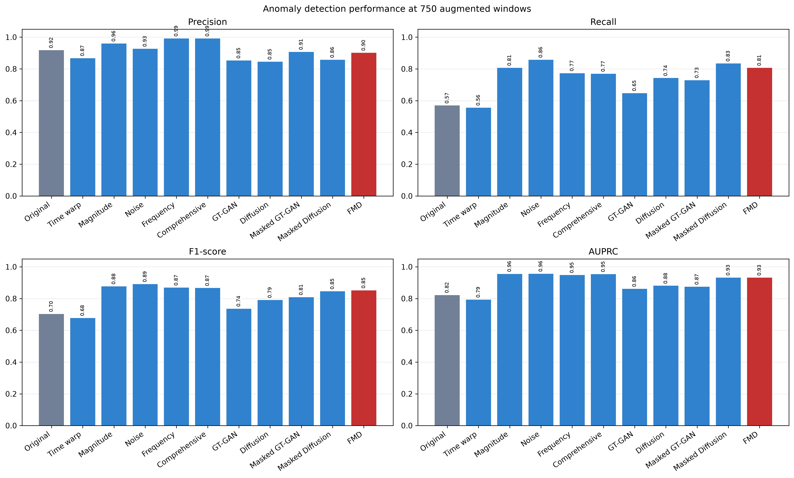

# 분할 수정 후 통일 조건 비교

이 페이지는 기존에 저장된 통일 조건 결과를 설명합니다. 현재 실행 경로를 검증하며 얻은 재실행 결과와 환경은 [별도 검증 기록](validation.md)에 구분했습니다.

루트 README의 Research01–10은 기존 연구 흐름과 당시 결과를 보존한 설명입니다. 기존 분할에서 원시 행 중첩이 발견되어 이후 별도의 통일 조건 비교를 수행했습니다. 두 결과의 평가 집합과 실험 조건을 혼합하면 안 됩니다.

아래 수치는 `section_4_3_unified/main_comparison.csv`의 저장된 결과입니다. 평가 집합은 정상 2,785개와 이상 295개, 총 3,080개 윈도우입니다. 정상 학습 5,000개, 실제 불량 seed 247개, 증강 조건별 750개를 사용하고 임계값은 검증 F1으로 선택했습니다.

| 방법 | Precision | Recall | F1 | AP |
|---|---:|---:|---:|---:|
| Original only | 0.9180 | 0.5695 | 0.7029 | 0.8221 |
| Magnitude warping | 0.9597 | 0.8068 | 0.8766 | 0.9552 |
| Noise injection | 0.9267 | 0.8576 | 0.8908 | 0.9561 |
| Masking Diffusion | 0.8571 | 0.8339 | 0.8454 | 0.9321 |
| FMD | 0.9015 | 0.8068 | 0.8515 | 0.9318 |

[전체 결과 CSV](results/main_comparison.csv) · [실험 코드](../Research/tools/research_section43_unified.py)

이 조건에서는 Noise injection이 가장 높은 F1을 기록했습니다. 생성형 방법이 전통적 증강보다 항상 우수하다는 결론을 지지하지 않습니다. 공개 정리 과정에서 재학습하거나 성능을 다시 검증한 결과는 아닙니다.
