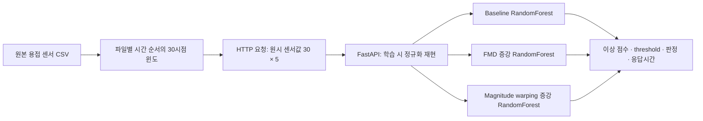

# Baseline · Magnitude warping · FMD API 비교

`baseline`은 Research01의 원본 데이터 RandomForest,
`magnitude_warping`은 Research05의 Magnitude warping 1,000개 증강(imbalanced) RandomForest,
`fmd`는 Research08의 Filtered Masking Diffusion 750개 증강 RandomForest다.
FMD 생성기는 오프라인 증강에 사용되며 API는 저장된 이상탐지 모델을 실행한다.
세 모델 모두 정상 학습 윈도 5,000개와 실제 이상 seed 247개, RF 300 trees를 사용한다.
기존 결과를 재현하기 위해 모델별 정상 샘플과 RF seed, 증강 수, validation threshold를 유지했다.



## 준비 및 실행

### 현재 PC에서 가장 쉽게 사용하는 방법

1. 탐색기에서 `C:\Users\gram\Desktop\Research` 폴더를 엽니다.
2. 루트의 **Start_API.cmd**를 더블클릭합니다. 서버가 준비되면 대시보드가 열립니다.
3. [대시보드](http://127.0.0.1:8000/)에서 정상·이상 샘플을 선택하고 **세 모델 비교 실행**을 누릅니다.
4. **10개 순서대로 재생**으로 저장 데이터를 시간 순서대로 보내거나, **전체 검증 결과** 탭에서 성능 비교를 확인합니다.
5. 종료할 때는 **Stop_API.cmd**를 더블클릭합니다. 브라우저를 닫는 것만으로 서버가 종료되지는 않습니다.

화면에 포함된 [자세한 사용 안내](http://127.0.0.1:8000/guide)는 실행·종료, 직접 입력,
Swagger, PowerShell, 원본 CSV 호출 예제와 문제 해결 방법을 제공합니다.
`127.0.0.1`은 현재 연구 PC의 주소입니다.

```powershell
cd "C:\Users\gram\Desktop\Research"
# 백그라운드 서버 실행 및 브라우저 열기
.\.venv-api\Scripts\python.exe tools\research11_service.py start --open
# 상태 확인
.\.venv-api\Scripts\python.exe tools\research11_service.py status
# 코드 수정 후 서버 재시작
.\.venv-api\Scripts\python.exe tools\research11_service.py restart --open
# 종료
.\.venv-api\Scripts\python.exe tools\research11_service.py stop
```

도우미는 실행 중인 서버의 명령·프로젝트 Python 경로·프로세스 생성 시각을 확인하고
자신이 관리하는 서버만 종료합니다. 다른 프로그램이 8000 포트를 쓰고 있으면 자동 종료하지 않습니다.

### 웹 화면에서 입력하고 결과를 읽는 방법

- **정상/이상 샘플**: 최종평가 CSV의 원시 30 × 5 윈도를 가져옵니다. 정답은 원본 데이터에 기록된 값이며 모델 판정과 별개입니다.
- **센서 미리보기**: RealPower 등 5개 센서의 30시점 값을 선택해 볼 수 있습니다.
- **요청 JSON 확인·수정 / 내 JSON 불러오기**: 정규화 전의 `feature_names`, `window`를 입력합니다. 직접 수정한 데이터에는 원본 정답을 표시하지 않습니다.
- **세 모델 비교 실행**: 실제 `POST /compare`를 호출합니다. 점수, 기준값, 정상/이상, 계산시간과 HTTP 왕복시간을 표시합니다.
- **10개 순서대로 재생**: 선택한 원본 윈도부터 시간 순서대로 최대 10개를 전송합니다. 각 응답 후 1초를 기다리는 시연이며 고정 도착률 부하 시험은 아닙니다.
- **응답 JSON 저장**: 현재 요청·응답·응답시간을 내려받습니다. 내려받은 묶음 전체 대신 `request` 안의 내용만 추론 입력으로 사용합니다.
- **전체 검증 결과**: 이전 3,081개 윈도 검증의 성능·지연과 그래프입니다. 방금 실행한 개별 요청의 값과 구분해 표시합니다.

화면의 JSON 입력에는 센서값 5개씩 30행이 필요합니다. 정규화는 서버가 수행합니다.
원본 CSV 업로드는 제공하지 않으며, Python에서 해당 열 30행을 추출하는 예시는 웹 사용 안내에 있습니다.

### 환경을 새로 구성하는 경우

현재 PC에서는 프로젝트 가상환경 `.venv-api`에 필요한 패키지가 준비되어 있다.
다른 환경에서는 Python 3.13 가상환경에 `requirements-api.txt`를 설치한다.
기존 연구 데이터가 같은 상대 경로에 있어야 모델을 다시 내보낼 수 있다.

```powershell
# 일반적인 새 환경
python -m venv .venv-api
.\.venv-api\Scripts\python.exe -m pip install -r requirements-api.txt

# 기존 실험 재현 및 모델 저장
.\.venv-api\Scripts\python.exe tools/research11_export_api_models.py

# 실제 HTTP 서버를 잠시 띄워 재생·부하 검증한 뒤 종료
.\.venv-api\Scripts\python.exe tools/research11_verify_api.py

# 직접 사용할 로컬 서버
# 백그라운드 도우미로 시작한 서버가 있으면 먼저 종료하세요.
.\.venv-api\Scripts\python.exe -m uvicorn fmd_api.app:app --host 127.0.0.1 --port 8000
```

서버가 실행 중일 때 [Swagger UI](http://127.0.0.1:8000/docs)에서 요청할 수 있다.
모델 파일은 `artifacts/research11/baseline.joblib`,
`artifacts/research11/magnitude_warping.joblib`, `artifacts/research11/fmd.joblib`에 있다.
각 파일에는 학습된 RF, 정규화 평균·표준편차, feature 순서, 윈도 크기, threshold가 포함된다.
`manifest.json`에는 데이터·코드·모델 해시와 기존 성능 재현 결과가 있다.
가상환경과 joblib 파일은 Git 추적에서 제외했다.

## 요청과 응답

| 경로 | 동작 |
| --- | --- |
| `GET /` | 브라우저 비교 대시보드 |
| `GET /guide` | 실행 및 사용 안내 웹페이지 |
| `GET /health` | 세 모델 로딩 상태 |
| `GET /models` | feature 순서·입력 규격·threshold·모델 해시·학습 설정 |
| `POST /predict/baseline` | baseline 모델 추론 |
| `POST /predict/magnitude_warping` | Magnitude warping 1,000개 증강 모델 추론 |
| `POST /predict/fmd` | FMD 증강 모델 추론 |
| `POST /compare` | 동일한 원시 윈도로 세 모델을 순차 실행해 비교 |

요청은 `feature_names`와 `window` 두 필드를 갖는다. Feature 순서는
`["RealPower", "GateOnTime", "SetPower", "Speed", "Length"]`이며,
`window`에는 시간 순서대로 센서값 5개씩 30개 행을 넣는다.
입력값은 정규화하기 전의 값이다. 파일·설비가 다른 관측치를 같은 윈도에 섞지 않는다.
API는 완성된 윈도를 입력받으며 센서 버퍼와 설비 연결은 데이터 생산자 측에서 담당한다.

실제 원본 데이터로 만든 요청을 다음처럼 전송할 수 있다.

```powershell
$requestBody = Get-Content -Raw -Encoding UTF8 data/research11/results/example_request.json
Invoke-RestMethod -Method Post -Uri http://127.0.0.1:8000/compare -ContentType 'application/json' -Body $requestBody
# Magnitude warping 모델만 호출
Invoke-RestMethod -Method Post -Uri http://127.0.0.1:8000/predict/magnitude_warping -ContentType 'application/json' -Body $requestBody
```

응답의 `anomaly_score`는 RF의 이상 클래스 점수이며 별도 확률 보정을 하지 않았다.
점수가 validation에서 정한 `threshold` 이상이면 `prediction=1`, `label="anomaly"`다.
`inference_ms`는 정규화와 모델 추론 시간이며 HTTP 왕복시간과는 다르다.
NaN/무한대·범위 초과·행/열 수·feature 순서 오류는 422, 없는 모델은 404로 응답한다.

## 증빙과 해석

[검증 보고서](../data/research11/results/api_verification_report.md)와
[구조화된 결과](../data/research11/results/api_verification_summary.json)에 실제 실행 결과를 기록했다.
요청별 예측, 지연시간, 부하 로그, 서버 로그, 입력·응답 예시와 파일 해시도 같은 폴더에 저장한다.
모델별 비교표는 `three_model_comparison.csv`, 성능과 FP/FN 그래프는
`three_model_comparison.png` 및 `.svg`다.
`run_status.json`은 최근 검증의 진행·완료·실패 상태를 표시한다.
이전 두 모델 검증 기록과 모델 파일은 `data/research11/archive/baseline_fmd_20260912T060036Z/`에 보관했다.

검증은 원본 CSV에서 기존 최종평가 split의 윈도를 복원해 종료 시각 순서로 가속 재생한다.
별도로 기본 초당 10개 요청 200회, 동시 클라이언트 4개 요청 40회를 실행한다.
각 `/predict` endpoint도 같은 대표 윈도 100개씩 호출해 단독 HTTP 왕복시간을 측정한다.
단독 측정은 모델 호출 순서를 교대하며 `single_model_requests.csv`에 기록한다.
이 부하 조건은 실제 공장의 요구 주기를 확인한 값이 아니다.

기존 split에는 seed–validation 원시 행 136개와 validation–final_test 원시 행 1개의 겹침이 있다.
기존 결과 재현을 위해 split은 유지했으며, 독립적인 일반화 성능 실험으로 해석하지 않는다.
세 모델의 정상 샘플과 RF seed, 증강 수도 기존 실험 설정에 따라 다르다.
API가 빠르게 응답하더라도 30시점을 수집하는 시간과 원본 데이터의 긴 시간 공백은 따로 고려해야 한다.
현재 증빙의 범위는 **저장된 실제 제조 데이터의 재생을 통한 로컬 API 적용과 추론 가능성**이다.
실제 설비 연결이나 장기 공장 운영을 입증한 자료는 아니다.

모델은 [FastAPI 공식 Lifespan 방식](https://fastapi.tiangolo.com/advanced/events/)으로
서버 시작 시 한 번 로드한다. 추론 서비스에는 생성기나 GPU가 필요하지 않다.
웹 화면은 [FastAPI 정적 파일 제공 방식](https://fastapi.tiangolo.com/tutorial/static-files/)으로
같은 서버에서 제공하며, 대시보드에는 외부 CDN이나 별도의 Node 서버가 필요하지 않다.
