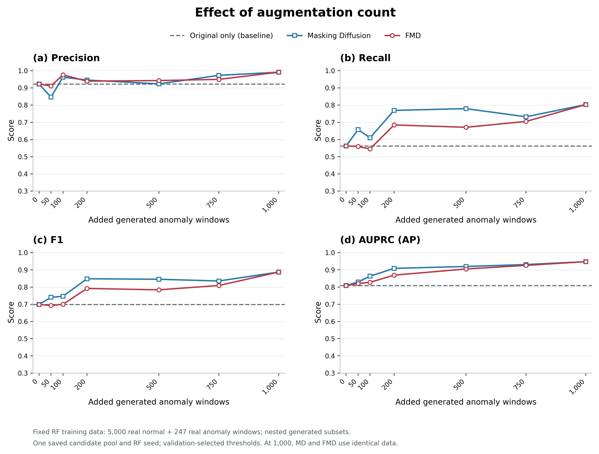
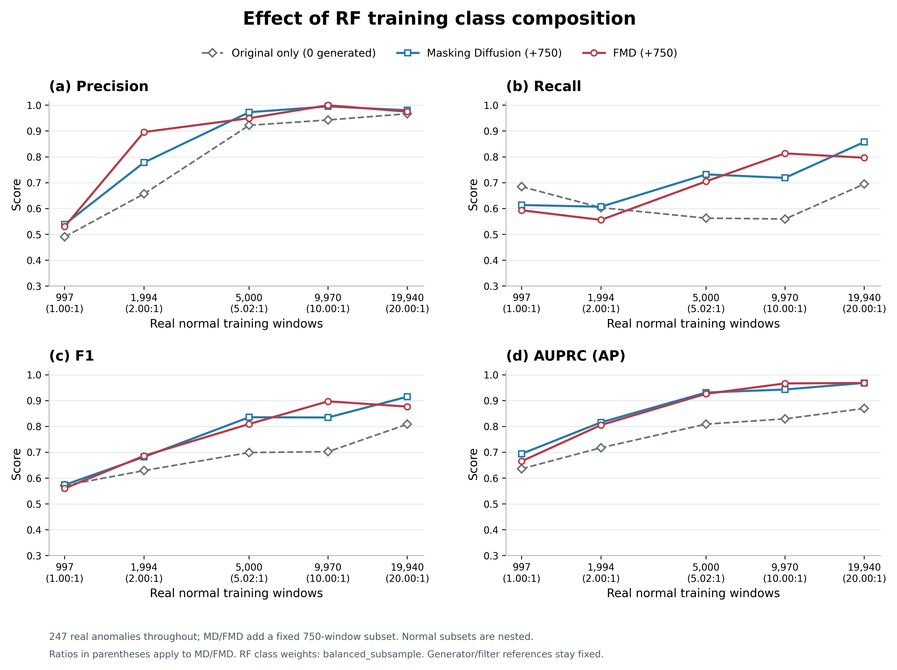

# 4.4.3. 클래스 균형 및 증강량의 영향

생성 데이터의 추가량과 학습 데이터의 클래스 구성이 이상탐지 성능에 미치는 영향을 분석하기 위해 두 가지 실험을 수행하였다. 첫 번째 실험에서는 정상 학습 윈도우 5,000개와 실제 불량 학습 윈도우 247개를 고정하고 생성 불량 윈도우 수를 0, 50, 100, 200, 500, 750 및 1,000개로 변화시켰다. 두 번째 실험에서는 실제 불량 247개와 생성 불량 750개를 유지한 상태에서 정상 학습 윈도우 수를 997, 1,994, 5,000, 9,970 및 19,940개로 변화시켜 증강 후 정상 대 불량 비율을 각각 1:1, 2:1, 약 5.02:1, 10:1 및 20:1로 구성하였다. 비교 대상은 Masking Diffusion과 FMD이며, 생성 데이터를 추가하지 않은 RandomForest를 기준선으로 사용하였다. 여기서 불량 수는 실제 불량과 생성 불량의 합을 의미한다.

모든 조건에 4.4.1과 동일한 RandomForest 설정과 난수 시드 42를 적용하였다. 트리 수는 300개, 리프 노드의 최소 표본 수는 2이며, 클래스 가중치는 balanced_subsample로 고정하였다. 따라서 제시한 클래스 비율은 원시 표본 수의 비율이며, 가중치 적용 후 각 클래스의 총 가중치 비율을 의미하지 않는다. 검증 집합은 정상 1,244개와 불량 164개, 최종 평가 집합은 정상 2,785개와 불량 295개로 모든 조건에서 동일하게 유지하였다. 이들 집합은 4.4.1과 동일하게 학습·참조 데이터와 원본 관측행이 중복되지 않도록 구성하였다. 판정 임계값은 0.05~0.95에서 0.01 간격으로 탐색하여 검증 F1을 최대화하는 값으로 선택하였다. 동률은 검증 Recall, Precision 순으로 비교하고, 남은 동률에서는 먼저 탐색한 임계값을 유지하였다. 최종 평가 결과는 임계값 선택에 사용하지 않았다. AUPRC는 average precision(AP)으로 계산하였다.

정상 및 생성 표본은 작은 조건의 표본 집합이 큰 조건에 포함되도록 구성하였다. 정상 5,000개 및 생성 750개 조건의 표본과 순서는 4.4.1과 동일하게 유지하였으며, 공통 조건의 성능이 재현됨을 확인하였다. 생성 모델을 다시 학습하지 않고 저장된 Masking Diffusion 후보 1,000개를 사용하였다. FMD의 기본 필터 설정, 품질 순위 및 참조 데이터도 실험 전체에서 고정하였다. 따라서 정상 학습 수의 변화는 다운스트림 RandomForest에 입력되는 정상 표본 수의 변화를 의미하며, 생성 모델과 필터를 구축하는 데 사용한 전체 데이터의 축소를 의미하지 않는다.

**표 C. 정상 5,000개를 고정했을 때 FMD 증강량에 따른 RandomForest 성능.**

| 생성 수 | 전체 불량 수 | 정상:불량 비율 | Precision | Recall | F1 | AUPRC(AP) |
|---:|---:|---:|---:|---:|---:|---:|
| 0 | 247 | 20.24:1 | 0.9222 | 0.5627 | 0.6989 | 0.8090 |
| 50 | 297 | 16.84:1 | 0.9116 | 0.5593 | 0.6933 | 0.8212 |
| 100 | 347 | 14.41:1 | 0.9758 | 0.5458 | 0.7000 | 0.8279 |
| 200 | 447 | 11.19:1 | 0.9395 | 0.6847 | 0.7922 | 0.8696 |
| 500 | 747 | 6.69:1 | 0.9429 | 0.6712 | 0.7842 | 0.9054 |
| 750 | 997 | 5.02:1 | 0.9498 | 0.7051 | 0.8093 | 0.9264 |
| 1,000 | 1,247 | 4.01:1 | 0.9916 | 0.8034 | 0.8876 | 0.9479 |

주: 전체 불량 수는 실제 불량 247개와 생성 불량의 합이다. 생성 수 0은 증강하지 않은 기준선이다. 1,000개 조건은 후보 전체를 사용하므로 필터링 전 Masking Diffusion과 동일하다. 모든 값은 하나의 저장된 생성 풀과 고정된 RF 난수 시드에 대한 결과이다.

**그림 B. 생성 불량 윈도우 수에 따른 RandomForest의 이상탐지 성능.** (a) Precision, (b) Recall, (c) F1 및 (d) AUPRC(AP). 정상 5,000개와 실제 불량 247개를 고정하였다. 점선은 생성 데이터를 사용하지 않은 기준선이다. 각 조건의 판정 임계값은 공통 검증 집합에서 선택하였다. 선은 단일 실행의 관측점을 연결하며 신뢰구간을 나타내지 않는다.

표 C와 그림 B에서 FMD의 증강량에 따른 성능 변화는 단조롭지 않았다. 50개를 추가한 조건의 F1은 0.6933으로 기준선의 0.6989보다 낮았으며, 100개 조건에서도 F1은 0.7000에 머물렀다. 200개 조건에서는 F1이 0.7922로 증가하였으나, 500개 조건에서는 0.7842로 소폭 감소하였다. 이후 750개 조건에서는 F1 0.8093과 AUPRC 0.9264를 나타냈다. AUPRC는 평가한 증강량 구간에서 지속적으로 증가하였지만, 조건별 임계값에서 측정한 Precision과 Recall은 서로 다른 변화를 보였다. 이는 생성 데이터 추가량에 따른 점수 순위의 변화와 특정 판정 임계값에서의 탐지 성능 변화를 구분하여 살펴볼 필요가 있음을 보여준다.

1,000개 조건에서는 F1 0.8876, Recall 0.8034 및 AUPRC 0.9479로, 본 증강량 실험에서 가장 높은 F1과 AUPRC가 관찰되었다. 다만 기본 필터의 통과 조건을 후보 1,000개가 모두 만족하였으므로, 이 조건은 품질 순위에 따른 일부 표본의 제외 없이 후보 전체를 사용하는 경우이다. 두 방법의 입력 순서까지 일치시킨 결과 Masking Diffusion과 FMD의 예측 및 성능이 동일하였다. 따라서 1,000개 조건의 성능을 품질 필터링의 개선 효과로 해석할 수 없다. 또한 50~750개 조건에서 FMD의 F1과 AUPRC는 동일 증강량의 Masking Diffusion보다 낮았으므로, 정상 5,000개를 사용하는 본 설정에서는 품질 순위에 따른 표본 선별의 추가 이점이 확인되지 않았다.

클래스 구성 실험에서는 생성 불량 750개와 실제 불량 247개를 고정하고 정상 학습 데이터 수만 변화시켰다. 각 정상 수에서 생성 데이터를 사용하지 않은 기준선도 함께 학습하여, 정상 데이터 증가에 따른 성능 변화와 같은 정상 수에서의 증강 효과를 비교하였다. 검증 및 최종 평가 집합의 클래스 비율은 변경하지 않았다.

**표 D. 생성 불량 750개를 고정했을 때 정상 학습 데이터 수와 클래스 비율에 따른 성능.**

| 정상 수 | 증강 후 정상:불량 비율 | 원본만 F1 | MD F1 | FMD F1 | FMD Recall | FMD AUPRC(AP) |
|---:|---:|---:|---:|---:|---:|---:|
| 997 | 1.00:1 | 0.5714 | 0.5737 | 0.5600 | 0.5932 | 0.6653 |
| 1,994 | 2.00:1 | 0.6290 | 0.6819 | 0.6862 | 0.5559 | 0.8054 |
| 5,000 | 5.02:1 | 0.6989 | 0.8356 | 0.8093 | 0.7051 | 0.9264 |
| 9,970 | 10.00:1 | 0.7021 | 0.8346 | 0.8972 | 0.8136 | 0.9666 |
| 19,940 | 20.00:1 | 0.8087 | 0.9150 | 0.8769 | 0.7966 | 0.9683 |

주: MD는 Masking Diffusion을 의미한다. 표의 클래스 비율은 MD와 FMD에 적용된다. 원본만 조건은 각 행과 동일한 정상 수와 실제 불량 247개를 사용하므로, 정상:불량 비율은 표의 증강 후 비율과 다르다. 정상 수가 변해도 방법별 생성 표본은 고정하였다.

**그림 C. 고정된 생성 불량 750개 조건에서 정상 학습 데이터 수에 따른 탐지 성능.** 가로축은 정상 학습 윈도우 수를 로그 척도로 표시하며, 괄호 안의 값은 MD와 FMD의 증강 후 정상:불량 비율이다. 원본만 조건에는 생성 표본을 추가하지 않았다. 모든 조건에 balanced_subsample 클래스 가중치를 적용하였다.

표 D에서 정상 997개와 전체 불량 997개로 구성한 1:1 조건의 FMD는 F1 0.5600을 나타냈다. 정상 수를 5,000개와 9,970개로 증가시키면 F1은 각각 0.8093과 0.8972로 높아졌다. 따라서 본 실험에서 정상 데이터를 줄여 완전한 클래스 균형을 맞추는 방식은 높은 탐지 성능으로 이어지지 않았다. 이는 정상 표본을 줄이는 과정에서 정상 패턴에 대한 학습 정보도 감소한다는 설명과 부합하지만, 정상 데이터의 분포 범위를 별도로 정량화하지 않았으므로 성능 변화의 원인으로 확정하지는 않는다.

정상 9,970개, 불량 997개인 10:1 조건에서 FMD의 F1은 0.8972로 평가한 다섯 구성 중 가장 높았으며, 동일 조건의 Masking Diffusion은 0.8346이었다. 그러나 정상 19,940개인 20:1 조건에서는 FMD의 F1이 0.8769로 감소한 반면 Masking Diffusion은 0.9150을 나타냈다. FMD의 AUPRC는 10:1 조건의 0.9666에서 20:1 조건의 0.9683으로 소폭 증가하였다. 이처럼 방법별 상대 성능과 지표의 변화 방향은 학습 구성에 따라 달라졌으며, 특정 클래스 비율에서 모든 지표가 동시에 최대가 되지는 않았다.

본 실험은 생성 불량을 추가하는 방식과 정상 표본 수를 조정하는 방식에 따라 서로 다른 성능 변화를 확인하였다. 다만 첫 번째 실험에서는 증강량과 클래스 비율이 함께 변하며, 두 번째 실험에서는 클래스 비율과 정상 데이터의 양 및 표본 구성이 함께 변한다. 따라서 두 실험으로 클래스 비율만의 독립적인 인과 효과를 분리했다고 볼 수는 없다. 또한 하나의 생성 후보 풀과 RF 난수 시드를 사용한 민감도 분석이므로, 관측된 최댓값을 일반적인 최적 증강량이나 최적 비율로 확정하지 않았다. 최종 설정의 선택은 검증 데이터에서 수행해야 하며, 반복 학습에 따른 안정성은 별도의 반복 평가에서 검토한다. 원본 관측행 중복을 제외했더라도 인접 구간과 동일 공정 기록 사이의 의존성이 남을 수 있으므로 외부 생산 기록에 대한 일반화 성능과도 구분한다.

---

작성 근거: [동일 조건 실험 결과와 설정](output/section_4_4_3/balance_count_results.json), [실험 재현 코드](tools/research_section443_balance_count.py), [그림 생성 코드](tools/plot_section443_balance_count.py), [그림 원자료 기록](output/section_4_4_3/figure_metadata.json).

작성 시 구분: 본 원고는 기존 Research08 증강량 그래프를 4.4.1과 동일한 평가 조건의 재실험 결과로 교체한 것이다. 25개의 서로 다른 RF 학습 조건을 평가했으며, 증강량 실험과 클래스 구성 실험이 공유하는 세 조건은 한 번 계산하여 양쪽에 사용하였다. 과거 Research08의 FMD 750개 F1 0.8739 및 1,000개 F1 0.8389를 본 표·그림과 혼합하지 않는다. 기존 입력 데이터와 과거 실험 결과는 수정하지 않았다. 표·그림 번호는 전체 원고에 맞춰 조정한다.
